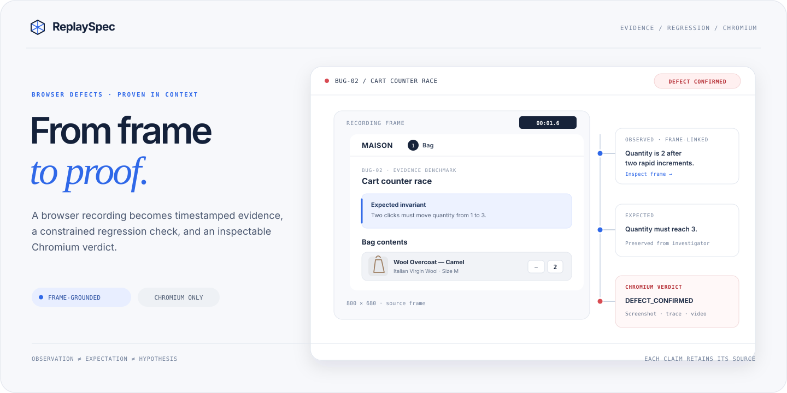
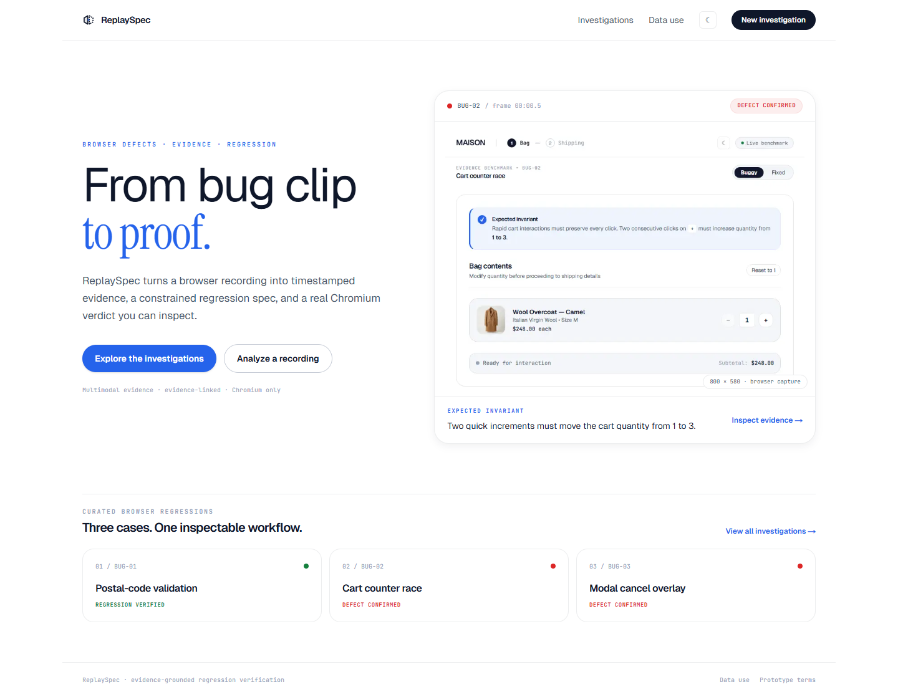
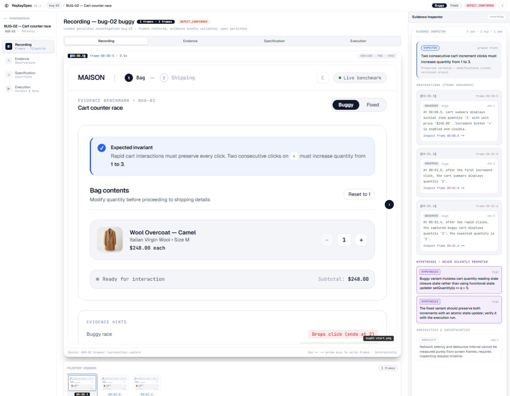
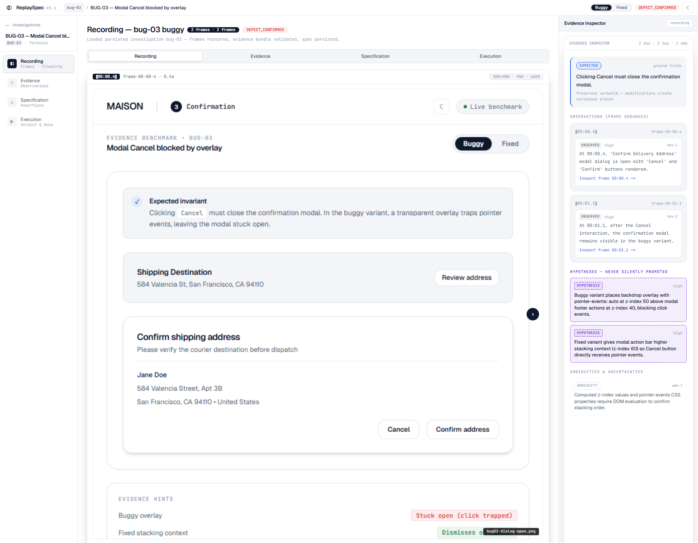

# ReplaySpec

**Turn browser bug recordings into evidence you can inspect and regressions you can verify.**

<p align="center">
  
</p>

ReplaySpec is a prototype browser investigation studio built for the Meta Global AI Developer Hackathon 2026. It connects timestamped recording evidence to a regression specification, then runs constrained checks in Chromium and reports what the browser observed.

> **Prototype status:** ReplaySpec is a local hackathon prototype. The built-in checkout is a demo and does not place real orders or collect payment. Live model access depends on your provider credentials and must be verified with an actual analysis request.

## Why ReplaySpec

Bug clips show what happened, but often leave teams guessing what should have happened and how to prevent a repeat. ReplaySpec keeps those pieces inspectable:

- **Observed** — statements grounded in a specific frame and timestamp.
- **Expected** — the behavior supplied by the investigator.
- **Hypothesis** — a possible explanation that still needs verification.
- **Ambiguity** — missing evidence that limits a confident conclusion.

The workflow is recording → timestamped frames → evidence review → regression specification → constrained Playwright execution → inspectable artifacts and verdict. Model responses are validated before they can inform the workflow; model-generated source code is not executed.

## Screenshots

The screenshots below are captured from the running prototype. They show the home page and two evidence reviews with the full browser frames visible beside their observations and expected behaviour.

<table>
  <tr>
    <td width="50%"><strong>Home</strong><br></td>
    <td width="50%"><strong>BUG-02 evidence review</strong><br></td>
  </tr>
  <tr>
    <td colspan="2"><strong>BUG-03 modal evidence</strong><br></td>
  </tr>
</table>

## Architecture

```mermaid
flowchart LR
    Person[Investigator] --> Studio[ReplaySpec web studio]
    Studio --> Intake[Recording intake API]
    Intake --> Store[Private local recording storage]
    Store --> Extract[Timestamped frame extraction]
    Extract --> Analyze[Analysis API]
    Analyze --> Provider[Configured vision model provider]
    Provider --> Validate[Schema and evidence validation]
    Validate --> Evidence[Evidence-linked investigation]
    Evidence --> Spec[Constrained regression specification]
    Spec --> Compile[Validated Playwright templates]
    Compile --> Gate[Demo-route allowlist]
    Gate --> Browser[Isolated Chromium run]
    Browser --> Demo[Bundled buggy or fixed scenario]
    Browser --> Artifacts[Screenshot, trace, and video artifacts]
    Demo --> Verdict[Four-state verdict]
    Artifacts --> Verdict
    Verdict --> Studio
```



The model boundary is provider-configurable. This workspace is set to OpenRouter's free-model router; the routed model can change and is not guaranteed to be from Meta. A real request succeeded during development, but returned a non-Meta model. Meta model access is not verified in this prototype. The presence of a key or configured status alone does not establish live analysis. See [Model setup](docs/MODEL_SETUP.md) for provider details.

Investigation and run artifacts are stored locally under `test-results/`, outside the public asset directory. The browser runner accepts only the bundled demo routes and uses scenario templates; it does not run source code returned by a model.

This prototype currently uses local file-backed persistence. It does not include hosted database storage, user accounts, or authentication.

## What is in the prototype

- A home page and investigations workspace for reviewing evidence and regression runs.
- Three curated browser scenarios, each with buggy and fixed variants:

  | Scenario | Demo route | Behavior under investigation |
  | --- | --- | --- |
  | BUG-01 — Checkout postal-code validation | `/demo/bug-01` | An empty postal code must show a validation error. |
  | BUG-02 — Cart counter race | `/demo/bug-02` | Two quick increments must move quantity from 1 to 3. |
  | BUG-03 — Modal cancel overlay | `/demo/bug-03` | Cancel must close the dialog without changing the saved address. |

- Recording intake and timestamped frame review.
- Evidence, specification, and execution views for investigations.
- Chromium runs with screenshots, traces, and explicit verdict states: `REGRESSION_VERIFIED`, `DEFECT_CONFIRMED`, `HARNESS_ERROR`, and `INCONCLUSIVE`.
- Optional server-side multimodal analysis through a configured provider. The current workspace uses OpenRouter's free-model router; its selected model can vary and Meta model access has not been verified.
- Privacy, prototype terms, and error/not-found pages.

## Run locally

### Requirements

- Node.js 20 or newer
- npm 10 or newer
- Playwright Chromium (`npx playwright install chromium`)
- FFmpeg and FFprobe on `PATH` for video recording intake

### Install and start

```bash
npm install
npx playwright install chromium
npm run dev
```

Open [http://localhost:3000](http://localhost:3000).

### Optional live model analysis

Model credentials are read on the server. Do not use a `NEXT_PUBLIC_` variable for an API key, commit `.env.local`, or paste a secret into source code.

1. Copy `.env.example` to `.env.local`.
2. Set the provider and its key in `.env.local`.
3. Set `REPLAYSPEC_LIVE_ANALYSIS=true` only when ready to send recording frames to that provider.
4. Restart the dev server and make an analysis request. The status endpoint only confirms configuration; it does not prove the provider accepted a request.

For the current OpenRouter free-model router:

```env
MODEL_PROVIDER=openrouter
OPENROUTER_API_KEY=your_openrouter_key
REPLAYSPEC_LIVE_ANALYSIS=true
```

This free router is not guaranteed to select a Meta model. Do not describe the project as using Meta AI until a Meta model endpoint has been configured and a successful analysis request has confirmed it. Provider IDs and setup details are in [Model setup](docs/MODEL_SETUP.md).

## Verification commands

```bash
npx tsc --noEmit
npm run lint
npx playwright test --workers=1
npm run build
```

These commands are provided for maintainers; a command listed here is not a claim that it has passed in every environment. See [Quality gates](docs/QUALITY_GATES.md) for project acceptance criteria.

## Security and scope

- Browser execution is intended for the bundled local demo routes; do not treat this prototype as a general-purpose remote-site runner.
- Generated checks use constrained templates and validated inputs rather than arbitrary model-written code.
- Run artifacts are stored outside the public asset directory.
- The demo checkout does not create an order, send a confirmation email, or collect payment.
- Live analysis sends selected recording frames and the investigator's prompt to the configured model provider. Use only recordings you are permitted to share with that provider.
- Meta Muse Spark Open is not verified as a live integration in this workspace; the provider configuration and a successful real analysis call are separate checks.

## Project docs

- [Product specification](docs/PRODUCT_SPEC.md)
- [Architecture](docs/ARCHITECTURE.md)
- [Quality gates](docs/QUALITY_GATES.md)
- [Research brief](docs/RESEARCH_BRIEF.md)
- [Model setup and provider notes](docs/MODEL_SETUP.md)
- [Data use / privacy](src/app/privacy/page.tsx)
- [Prototype terms](src/app/terms/page.tsx)

## Repository layout

```text
src/app/                 Routes, pages, and API handlers
src/components/           Investigation workspace components
src/lib/                  Evidence, model adapters, storage, specs, and runner
public/demo/              Curated scenario frame assets
docs/                     Product, architecture, research, and quality docs
tests/                    Unit, API, and browser regression coverage
```

## Hackathon demo flow

1. Open **Investigations** and choose a curated benchmark.
2. Review the recording and jump between timestamped frames.
3. Show how an observation links back to its source frame, separately from expected behavior and hypotheses.
4. Open the specification and inspect the constrained regression check.
5. Run the buggy and fixed variants in Chromium; explain the verdict using the browser artifacts.

Keep the claim precise: a benchmark run demonstrates the app's browser-verification workflow; it does not by itself establish that live model analysis is configured or available.

## Built with

Next.js, React, TypeScript, Tailwind CSS, Zod, and Playwright.
