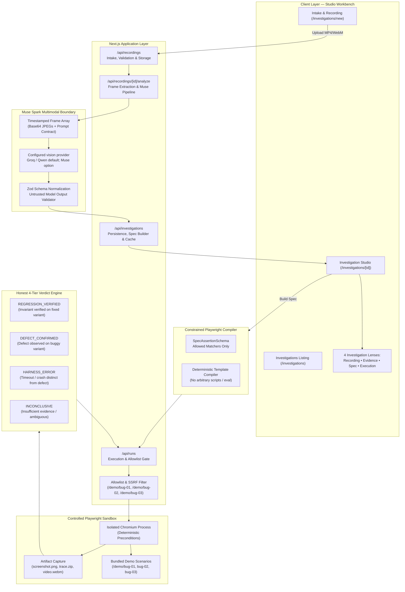

# ReplaySpec — System Architecture
**Evidence-Grounded Browser Investigation & Regression Verification Platform**
*Meta Global AI Developer Hackathon 2026*

---

## 1. High-Level Architecture Diagram

---

## 2. Core Subsystems

### A. Recording Intake & Safe Storage
- **File Validation**: Accepts MP4 and WebM up to 50MB and 120s duration. Magic byte verification (`ftyp` for MP4, EBML `0x1A45DFA3` for WebM).
- **Storage Isolation**: Recordings and extracted frames are stored under `test-results/recordings/` outside the web server's `public/` directory. Path traversal attempts are rejected via canonical path resolution.

### B. Frame Extraction Engine
- **Parallel Processing**: Video duration is probed via `ffprobe`, followed by non-blocking parallel extraction of chronological keyframes using `ffmpeg` via `execFileAsync`.
- **Timestamp Integrity**: Preserves exact frame timestamps (`mm:ss.s`), generating deterministic `frameId` tokens (`frame-00-01-8`) with verified resolution.

### C. Configured Multimodal Analysis Boundary
- **Current default**: Groq `qwen/qwen3.8-27b`. Meta Muse Spark Open is an optional model route, not the current default; it requires an account and credentials at a provider that grants access. Provider/model IDs live in `src/lib/muse/provider.ts` and may change with provider availability.
- **Provider Protocol**: OpenAI-compatible chat completion payload with interleaved base64 image frames.
- **Zero-Trust Boundary**: Model output is treated as untrusted JSON input. The payload is parsed and strictly validated against Zod schemas. Any invalid JSON, missing provenance, or fabricated IDs are rejected.
- **Strict Evidence Taxonomy**:
  - `OBSERVED`: Ground truth facts directly visible in specific frames (`VISUAL_FRAME`).
  - `EXPECTED`: User-authored invariant specification preserved verbatim.
  - `HYPOTHESIS`: Inferred explanations or root causes requiring test verification.
  - `AMBIGUITY`: Explicit gaps or missing evidence preventing definitive conclusions.

### D. Constrained Playwright Compiler
- **Safety Guarantee**: ReplaySpec **never executes arbitrary LLM-generated code or unrestricted shell scripts**.
- **Whitelisted Matchers**: Only typed assertion types (`VISIBLE`, `HIDDEN`, `CONTAINS_TEXT`, `VALUE_EQUALS`, `ARIA_INVALID`) mapped to validated selector targets.
- **Deterministic Generation**: Generated Playwright test code uses strict structural templates with enforced precondition checks and timeout controls.

### E. Isolated Playwright Execution Runner
- **Target Allowlisting**: Server-side allowlist (`src/lib/allowlist.ts`) restricts execution strictly to bundled internal scenarios (`/demo/bug-01`, `/demo/bug-02`, `/demo/bug-03`). External URLs and private network SSRF vectors are rejected with HTTP 422.
- **Scenario Templates**: A validated `bugId` selects one fixed browser procedure for postal validation, cart increments, or modal cancellation. The request target must match that scenario and variant; user or model source code is never executed.
- **Artifact Retention**: Every execution automatically saves `screenshot.png`, `trace.zip`, and `video.webm` in an isolated directory `test-results/runs/<runId>/`.

### F. Honest 4-Tier Verdict Engine
1. **`REGRESSION_VERIFIED`**: The selected scenario's expected invariant passes in its fixed variant.
2. **`DEFECT_CONFIRMED`**: Buggy behavior successfully reproduced (e.g. error element hidden via `display:none` or state desynchronization).
3. **`HARNESS_ERROR`**: Target unreachable, locator timed out, or browser crashed. Never misclassified as an application defect. Rendered in distinct violet styling.
4. **`INCONCLUSIVE`**: Test run did not yield conclusive evidence to confirm or refute the specification.

---

## 3. Security Architecture & Threat Mitigations

| Threat Vector | Mitigation Strategy |
|---|---|
| Arbitrary Code Execution | Code compiler only accepts typed AST assertions; no `eval()` or unconstrained shell execution. |
| SSRF / Malicious Target URLs | Strict server-side URL regex allowlisting restricting navigation to internal test routes. |
| Path Traversal in Artifacts | Canonical path validation ensuring all requested files remain within `test-results/`. |
| Credential Leakage | Provider-specific server-only environment variables (for example, `GROQ_API_KEY` or `BASETEN_API_KEY`). API responses and client bundles must never expose keys. |
| Denial of Service via Huge Media | Max upload size capped at 50MB, max duration capped at 120s, magic bytes verified. |
